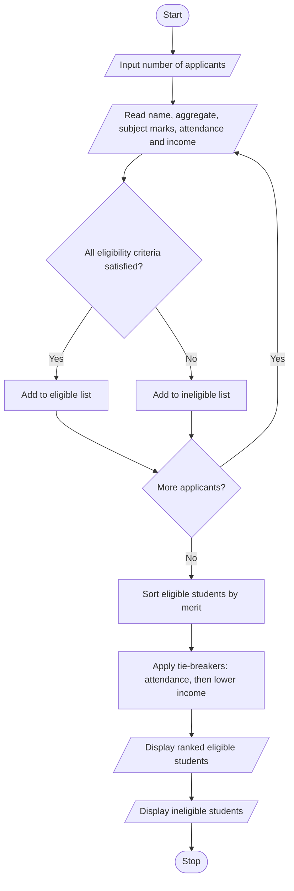

# 1. Problem Statement
To develop a scholarship allocation system that evaluates students based on aggregate marks, subject-wise minimum marks, attendance percentage, and family income. The system identifies eligible students, ranks them according to their academic performance, and resolves ties using predefined rules. Finally, it displays the eligible students in merit order.
# 2. Algorithm
1. Start.
2. Input the number of applicants.
3. For each applicant, read name, aggregate marks, subject marks, attendance, and annual family income.
4. Check the eligibility criteria:
   - Aggregate marks ≥ 75%.
   - Each subject mark ≥ 60%.
   - Attendance ≥ 75%.
   - Annual family income ≤ ₹2,50,000.
5. If all conditions are satisfied, mark the student as eligible; otherwise, mark them as ineligible.
6. Sort eligible students using these tie-breaking rules:
   - Higher aggregate marks first.
   - Higher attendance next.
   - Lower family income next.
7. Display eligible students in merit order.
8. Display ineligible students separately.
9. Stop.
Note: These are sample eligibility rules for the project. Actual scholarship rules may differ.
# 3. Flowchart (Mermaid)

# 4. Source Code (Python)

# University Scholarship Allocation System

MIN_AGGREGATE = 75
MIN_SUBJECT_MARK = 60
MIN_ATTENDANCE = 75
MAX_INCOME = 250000

n = int(input("Enter number of applicants: "))

eligible = []
ineligible = []

for i in range(n):
    print(f"\nApplicant {i + 1}")

    name = input("Enter name: ")
    aggregate = float(input("Enter aggregate marks (%): "))

    subject_count = int(input("Enter number of subjects: "))
    subject_marks = []

    for j in range(subject_count):
        mark = float(input(f"Enter subject {j + 1} marks (%): "))
        subject_marks.append(mark)

    attendance = float(input("Enter attendance (%): "))
    income = float(input("Enter annual family income (Rs.): "))

    if (aggregate >= MIN_AGGREGATE
            and all(m >= MIN_SUBJECT_MARK for m in subject_marks)
            and attendance >= MIN_ATTENDANCE
            and income <= MAX_INCOME):

        eligible.append({
            "name": name,
            "aggregate": aggregate,
            "attendance": attendance,
            "income": income
        })
    else:
        ineligible.append(name)

# Ranking: aggregate descending, attendance descending,
# and annual family income ascending.
eligible.sort(
    key=lambda s: (
        -s["aggregate"],
        -s["attendance"],
        s["income"]
    )
)

print("\n--- SCHOLARSHIP MERIT LIST ---")

if eligible:
    for rank, student in enumerate(eligible, start=1):
        print(
            f"{rank}. {student['name']} | "
            f"Aggregate: {student['aggregate']:.1f}% | "
            f"Attendance: {student['attendance']:.1f}% | "
            f"Income: Rs.{student['income']:.0f}"
        )
else:
    print("No eligible students.")

print("\n--- INELIGIBLE STUDENTS ---")

if ineligible:
    for name in ineligible:
        print(name)
else:
    print("None")
# 5. Sample Input
Enter number of applicants: 4

Applicant 1
Enter name: Ravi
Enter aggregate marks (%): 85
Enter number of subjects: 3
Enter subject 1 marks (%): 80
Enter subject 2 marks (%): 85
Enter subject 3 marks (%): 90
Enter attendance (%): 90
Enter annual family income (Rs.): 200000

Applicant 2
Enter name: Sita
Enter aggregate marks (%): 85
Enter number of subjects: 3
Enter subject 1 marks (%): 80
Enter subject 2 marks (%): 85
Enter subject 3 marks (%): 90
Enter attendance (%): 95
Enter annual family income (Rs.): 180000

Applicant 3
Enter name: Arun
Enter aggregate marks (%): 72
Enter number of subjects: 3
Enter subject 1 marks (%): 70
Enter subject 2 marks (%): 75
Enter subject 3 marks (%): 71
Enter attendance (%): 90
Enter annual family income (Rs.): 150000

Applicant 4
Enter name: Priya
Enter aggregate marks (%): 80
Enter number of subjects: 3
Enter subject 1 marks (%): 75
Enter subject 2 marks (%): 80
Enter subject 3 marks (%): 85
Enter attendance (%): 80
Enter annual family income (Rs.): 240000
# 6. Sample Output
--- SCHOLARSHIP MERIT LIST ---
1. Sita | Aggregate: 85.0% | Attendance: 95.0% | Income: Rs.180000
2. Ravi | Aggregate: 85.0% | Attendance: 90.0% | Income: Rs.200000
3. Priya | Aggregate: 80.0% | Attendance: 80.0% | Income: Rs.240000

--- INELIGIBLE STUDENTS ---
Arun
# 7. Output Screenshot

