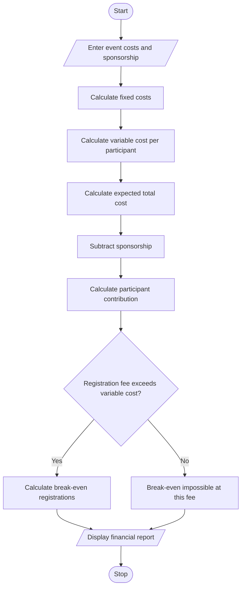

# 1. Problem statement
Develop a Python program to calculate campus event expenses, including venue, equipment, catering, transport, and certificates. Determine participant contributions, sponsorship shortfalls, and the minimum number of registrations required to break even.
# 2. Algorithm
1. Enter fixed expenses and per-participant costs.
2. Enter sponsorship amount, registration fee, and expected participants.
3. Calculate the total event cost.
4. Calculate the amount remaining after sponsorship.
5. Calculate the contribution required per participant.
6. Calculate the minimum registrations needed to break even.
7. Display the financial report.
# 3. Flowchart (Mermaid)

# 4. Python source code

import math

print("CAMPUS EVENT FINANCIAL PLANNER")

venue = float(input("Venue cost: "))
equipment = float(input("Equipment cost: "))
catering = float(input("Catering cost per person: "))
transport = float(input("Transport cost per person: "))
certificate = float(input("Certificate cost per person: "))
sponsorship = float(input("Sponsorship amount: "))
fee = float(input("Registration fee per person: "))
participants = int(input("Expected participants: "))

values = [venue, equipment, catering, transport,
          certificate, sponsorship, fee]

if min(values) < 0 or participants <= 0:
    print("Invalid input")
else:
    fixed_cost = venue + equipment
    variable_cost = catering + transport + certificate
    total_cost = fixed_cost + variable_cost * participants
    shortfall = max(0, total_cost - sponsorship)
    contribution = shortfall / participants

    print("\n--- EVENT FINANCIAL REPORT ---")
    print("Total Event Cost: Rs.", round(total_cost, 2))
    print("Sponsorship: Rs.", round(sponsorship, 2))
    print("Funding Shortfall: Rs.", round(shortfall, 2))
    print("Contribution per Person: Rs.",
          round(contribution, 2))

    if fee > variable_cost:
        break_even = max(
            0, math.ceil((fixed_cost - sponsorship) /
                         (fee - variable_cost)))
        print("Break-even Registrations:", break_even)
    else:
        print("Break-even: Not possible at this fee")
# 5. Sample input
Venue cost: 10000
Equipment cost: 5000
Catering cost per person: 200
Transport cost per person: 50
Certificate cost per person: 50
Sponsorship amount: 10000
Registration fee per person: 400
Expected participants: 100
# 6. Sample output
--- EVENT FINANCIAL REPORT ---
Total Event Cost: Rs. 45000.0
Sponsorship: Rs. 10000.0
Funding Shortfall: Rs. 35000.0
Contribution per Person: Rs. 350.0
Break-even Registrations: 20
# 7. Output screenshot

