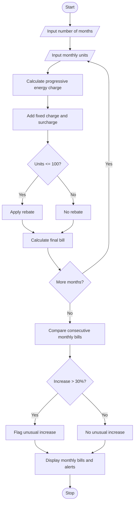

# 1. Problem Statement
Develop a Python program to calculate household electricity bills using progressive consumption slabs, fixed charges, surcharges, and rebates. The program should compare bills across multiple months and identify unusual increases in monthly bills.

Sample billing rules:
Component	Rate
First 100 units	₹1.50 per unit
Next 100 units	₹2.50 per unit
Above 200 units	₹4.00 per unit
Fixed charge	₹50
Surcharge	5% of energy charge
Rebate	5% of energy charge if consumption is at most 100 units

These rates are illustrative for an academic project, not an official electricity tariff.
# 2. Algorithm
1. Start.
2. Input the number of months and electricity consumption for each month.
3. Calculate the energy charge using progressive slabs.
4. Add the fixed charge of ₹50.
5. Calculate a 5% surcharge on the energy charge.
6. Apply a 5% rebate on the energy charge if consumption is at most 100 units.
7. Calculate the final bill.
8. Compare each month's bill with the previous month's bill.
9. If the bill increases by more than 30%, flag it as an unusual increase.
10. Display monthly billing details and alerts.
11. Stop.
# 3. Flowchart (Mermaid)

# 4. Source Code (Python)

# Progressive Electricity Billing System

FIXED_CHARGE = 50
SURCHARGE_RATE = 0.05
REBATE_RATE = 0.05
INCREASE_LIMIT = 30

def calculate_energy_charge(units):
    if units <= 100:
        return units * 1.50
    elif units <= 200:
        return (100 * 1.50) + ((units - 100) * 2.50)
    else:
        return (100 * 1.50) + (100 * 2.50) + (
            (units - 200) * 4.00
        )

n = int(input("Enter number of months: "))
bills = []

for i in range(n):
    print(f"\nMonth {i + 1}")
    units = float(input("Enter electricity units: "))

    if units < 0:
        print("Units cannot be negative.")
        continue

    energy = calculate_energy_charge(units)
    surcharge = energy * SURCHARGE_RATE
    rebate = energy * REBATE_RATE if units <= 100 else 0

    total = energy + FIXED_CHARGE + surcharge - rebate

    bills.append({
        "month": i + 1,
        "units": units,
        "energy": energy,
        "surcharge": surcharge,
        "rebate": rebate,
        "total": total
    })

print("\n--- MONTHLY ELECTRICITY BILL ---")

for i, bill in enumerate(bills):
    print(f"\nMonth {bill['month']}")
    print(f"Units consumed: {bill['units']:.0f}")
    print(f"Energy charge: Rs.{bill['energy']:.2f}")
    print(f"Fixed charge: Rs.{FIXED_CHARGE:.2f}")
    print(f"Surcharge: Rs.{bill['surcharge']:.2f}")
    print(f"Rebate: Rs.{bill['rebate']:.2f}")
    print(f"Total bill: Rs.{bill['total']:.2f}")

    if i > 0:
        previous = bills[i - 1]["total"]
        current = bill["total"]

        if previous > 0:
            increase = ((current - previous) / previous) * 100
            print(f"Change from previous month: {increase:.2f}%")

            if increase > INCREASE_LIMIT:
                print("ALERT: Unusual bill increase!")
# 5. Sample Input
Enter number of months: 4

Month 1
Enter electricity units: 80

Month 2
Enter electricity units: 120

Month 3
Enter electricity units: 220

Month 4
Enter electricity units: 300
# 6. Sample Output
--- MONTHLY ELECTRICITY BILL ---

Month 1
Units consumed: 80
Energy charge: Rs.120.00
Fixed charge: Rs.50.00
Surcharge: Rs.6.00
Rebate: Rs.6.00
Total bill: Rs.170.00

Month 2
Units consumed: 120
Energy charge: Rs.200.00
Fixed charge: Rs.50.00
Surcharge: Rs.10.00
Rebate: Rs.0.00
Total bill: Rs.260.00
Change from previous month: 52.94%
ALERT: Unusual bill increase!

Month 3
Units consumed: 220
Energy charge: Rs.480.00
Fixed charge: Rs.50.00
Surcharge: Rs.24.00
Rebate: Rs.0.00
Total bill: Rs.554.00
Change from previous month: 113.08%
ALERT: Unusual bill increase!

Month 4
Units consumed: 300
Energy charge: Rs.800.00
Fixed charge: Rs.50.00
Surcharge: Rs.40.00
Rebate: Rs.0.00
Total bill: Rs.890.00
Change from previous month: 60.65%
ALERT: Unusual bill increase!
# 7. Output Screenshot

