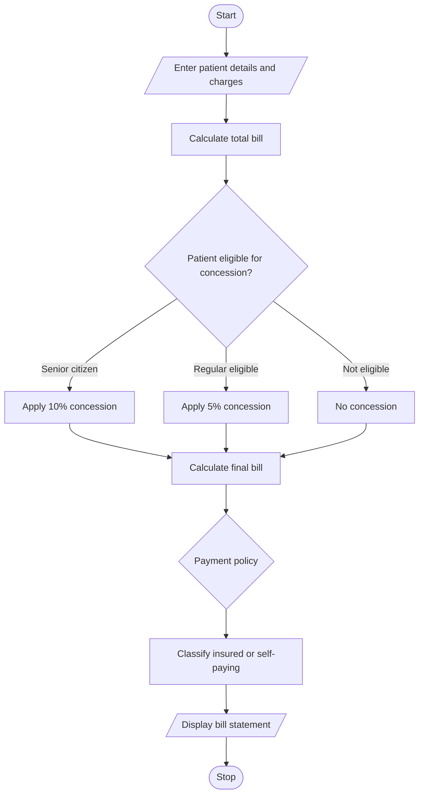

# 1. Problem statement
Develop a Python program to calculate a patient's hospital bill using consultation, diagnostic, and treatment charges. Apply concessions based on patient category, validate the bill, and classify the patient according to the payment policy.
# 2. Algorithm
1. Start.
2. Read consultation, diagnostic, and treatment charges.
3. Calculate the total bill.
4. Apply a 10% concession for senior citizens or a 5% concession for eligible regular patients.
5. Calculate the final bill.
6. Classify the patient as insured or self-paying.
7. Display the bill details.
8. Stop.
# 3. Flowchart (Mermaid)

 # 4. Python source code
 
print("HOSPITAL BILLING SYSTEM")

consultation = float(input("Consultation charge: "))
diagnostic = float(input("Diagnostic charge: "))
treatment = float(input("Treatment charge: "))

category = input("Patient category (senior/regular/other): ").lower()
payment = input("Payment type (insured/self): ").lower()

if min(consultation, diagnostic, treatment) < 0:
    print("Invalid charges")
else:
    total = consultation + diagnostic + treatment

    if category == "senior":
        discount = total * 0.10
    elif category == "regular":
        discount = total * 0.05
    else:
        discount = 0

    final_bill = total - discount

    if payment == "insured":
        classification = "Insured Patient"
    elif payment == "self":
        classification = "Self-Paying Patient"
    else:
        classification = "Invalid Payment Type"

    print("\n--- BILL STATEMENT ---")
    print("Total Bill: Rs.", round(total, 2))
    print("Concession: Rs.", round(discount, 2))
    print("Final Bill: Rs.", round(final_bill, 2))
    print("Classification:", classification)
# 5. Sample input
Consultation charge: 500
Diagnostic charge: 1500
Treatment charge: 3000
Patient category (senior/regular/other): senior
Payment type (insured/self): insured
# 6. Sample output
--- BILL STATEMENT ---
Total Bill: Rs. 5000.0
Concession: Rs. 500.0
Final Bill: Rs. 4500.0
Classification: Insured Patient
# 7. Output screenshot

