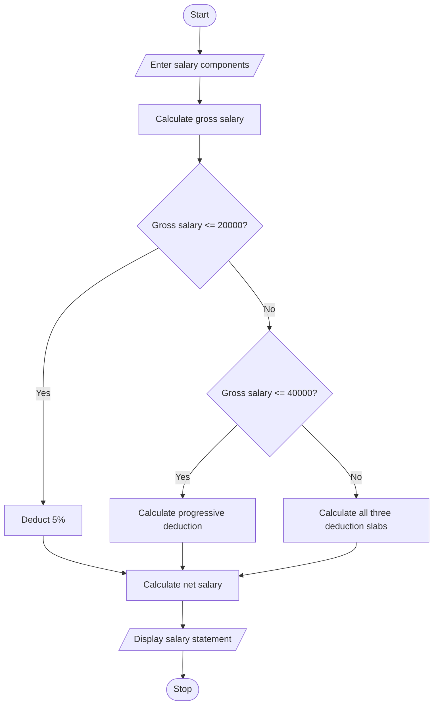

# 1. Problem statement
Write a Python program to calculate an employee's gross salary using basic pay, allowances, overtime, and incentives. Apply progressive deductions and display a formatted salary statement.
# 2. Algorithm
1. Read basic pay, allowances, overtime pay, and incentives.
2. Calculate gross salary.
3. Calculate progressive deductions: 5% on the first ₹20,000, 10% on the next ₹20,000, and 15% on the amount above ₹40,000.
4. Calculate net salary.
5. Display the salary statement.
# 3. Flowchart (Mermaid)

# 4. Python source code

print("EMPLOYEE PAYROLL SYSTEM")

basic = float(input("Basic pay: "))
allowances = float(input("Allowances: "))
overtime = float(input("Overtime pay: "))
incentives = float(input("Incentives: "))

if min(basic, allowances, overtime, incentives) < 0:
    print("Invalid salary details")
else:
    gross = basic + allowances + overtime + incentives

    if gross <= 20000:
        deduction = gross * 0.05
    elif gross <= 40000:
        deduction = 20000 * 0.05 + (gross - 20000) * 0.10
    else:
        deduction = (20000 * 0.05 +
                     20000 * 0.10 +
                     (gross - 40000) * 0.15)

    net = gross - deduction

    print("\n--- SALARY STATEMENT ---")
    print("Basic Pay: Rs.", basic)
    print("Gross Salary: Rs.", round(gross, 2))
    print("Deduction: Rs.", round(deduction, 2))
    print("Net Salary: Rs.", round(net, 2))
# 5. Sample input
Basic pay: 30000
Allowances: 5000
Overtime pay: 2000
Incentives: 3000
# 6. Sample output
--- SALARY STATEMENT ---
Basic Pay: Rs. 30000.0
Gross Salary: Rs. 40000.0
Deduction: Rs. 3000.0
Net Salary: Rs. 37000.0
# 7. Output screenshot

