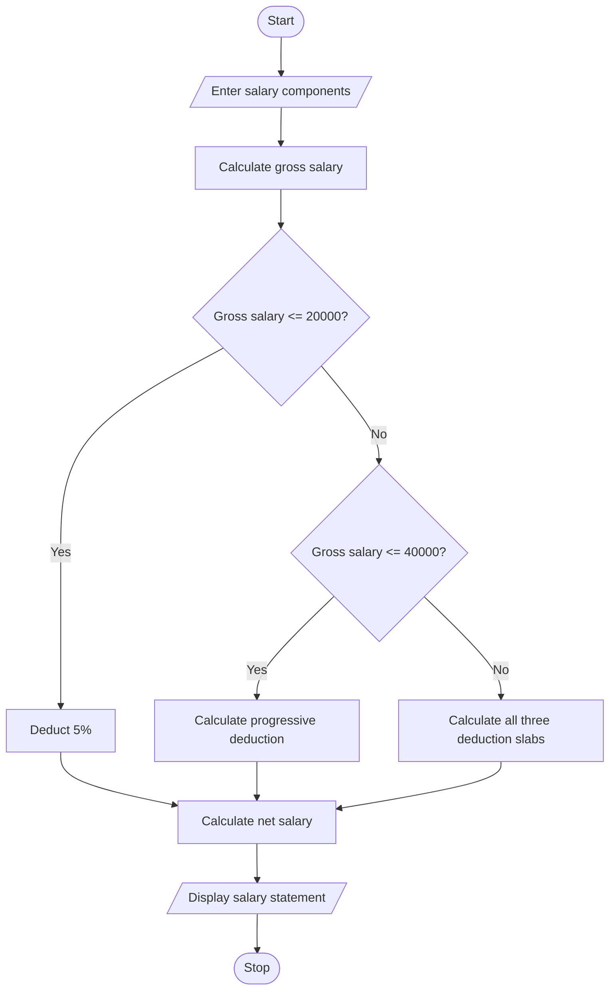

# 1. Problem statement
Develop a program to compare multiple mobile plans using monthly cost, data usage, call usage, validity, and budget. Calculate extra charges and identify the cheapest eligible plan.
# 2. Algorithm
1. Enter data usage, call minutes, and budget.
2. Define three mobile plans with different prices and limits.
3. Calculate excess data and call charges for each plan.
4. Check whether the plan satisfies usage, validity, and budget constraints.
5. Select the least expensive eligible plan.
6. Display the results.
# 3. Flowchart (Mermaid)

# 4. Python source code

print("EMPLOYEE PAYROLL SYSTEM")

basic = float(input("Basic pay: "))
allowances = float(input("Allowances: "))
overtime = float(input("Overtime pay: "))
incentives = float(input("Incentives: "))

if min(basic, allowances, overtime, incentives) < 0:
    print("Invalid salary details")
else:
    gross = basic + allowances + overtime + incentives

    if gross <= 20000:
        deduction = gross * 0.05
    elif gross <= 40000:
        deduction = 20000 * 0.05 + (gross - 20000) * 0.10
    else:
        deduction = (20000 * 0.05 +
                     20000 * 0.10 +
                     (gross - 40000) * 0.15)

    net = gross - deduction

    print("\n--- SALARY STATEMENT ---")
    print("Basic Pay: Rs.", basic)
    print("Gross Salary: Rs.", round(gross, 2))
    print("Deduction: Rs.", round(deduction, 2))
    print("Net Salary: Rs.", round(net, 2))
# 5. Sample input
Basic pay: 30000
Allowances: 5000
Overtime pay: 2000
Incentives: 3000
# 6. Sample output
--- SALARY STATEMENT ---
Basic Pay: Rs. 30000.0
Gross Salary: Rs. 40000.0
Deduction: Rs. 3000.0
Net Salary: Rs. 37000.0
# 7. Output screenshot

