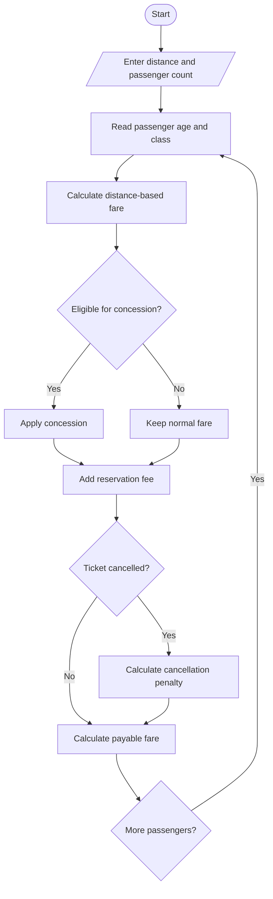

# 1. Problem statement
Create a Python program to calculate railway fares for multiple passengers using distance-based fare slabs, travel classes, age-based concessions, reservation fees, and cancellation penalties.
# 2. Algorithm
1. Enter the travel distance and number of passengers.
2. Enter each passenger's age and travel class.
3. Calculate the base fare using the distance and class rate.
4. Apply a concession for eligible senior passengers.
5. Add the reservation fee.
6. Calculate cancellation penalties if applicable.
7. Display the total fare.
# 3. Flowchart (Mermaid)

# 4. Python source code

print("RAILWAY FARE CALCULATOR")

distance = float(input("Distance in km: "))
n = int(input("Number of passengers: "))
cancel = input("Cancel tickets? (yes/no): ").lower()

rates = {"sleeper": 1.0, "ac": 2.0, "first": 3.0}
total = 0

if distance <= 0 or n <= 0:
    print("Invalid input")
else:
    for i in range(n):
        age = int(input("Passenger age: "))
        travel_class = input(
            "Class (sleeper/ac/first): ").lower()

        if travel_class not in rates or age < 0:
            print("Invalid passenger details")
            continue

        fare = distance * rates[travel_class]

        if age >= 60:
            fare *= 0.80

        fare += 40  # Reservation fee

        if cancel == "yes":
            penalty = fare * 0.20
            fare -= penalty

        total += fare

        print("Passenger", i + 1,
              "Fare: Rs.", round(fare, 2))

    print("Total Fare: Rs.", round(total, 2))
# 5. Sample input
Distance in km: 200
Number of passengers: 2
Cancel tickets? (yes/no): no
Passenger age: 25
Class (sleeper/ac/first): sleeper
Passenger age: 65
Class (sleeper/ac/first): ac
# 6. Sample output
Passenger 1 Fare: Rs. 240.0
Passenger 2 Fare: Rs. 360.0
Total Fare: Rs. 600.0
# 7. Output screenshot

    L -- No --> M[/Display final fare/]
    M --> N([Stop])
