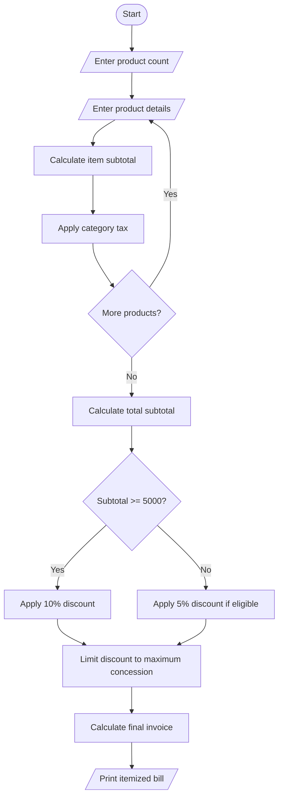

# 1. Problem statement
Write a Python program to process multiple products and quantities, calculate category-specific taxes, apply discounts based on purchase thresholds, enforce a maximum concession limit, and generate an itemized invoice.
# 2. Algorithm
1. Read the number of products.
2. Enter each product's name, category, price, and quantity.
3. Calculate the subtotal for each product.
4. Apply category-specific tax rates.
5. Apply a threshold discount.
6. Limit the discount to the maximum concession allowed.
7. Display the itemized invoice and final total.
# 3. Flowchart (Mermaid)

# 4. Python source code

print("RETAIL BILLING SYSTEM")

n = int(input("Number of products: "))
subtotal = 0
tax_total = 0

tax_rates = {"food": 0.05, "clothing": 0.05,
             "electronics": 0.18}

if n <= 0:
    print("Invalid product count")
else:
    for i in range(n):
        name = input("Product name: ")
        category = input(
            "Category (food/clothing/electronics): ").lower()
        price = float(input("Unit price: "))
        qty = int(input("Quantity: "))

        if category not in tax_rates or price < 0 or qty <= 0:
            print("Invalid product details")
            continue

        amount = price * qty
        tax = amount * tax_rates[category]
        subtotal += amount
        tax_total += tax

        print(name, "Amount:", round(amount, 2),
              "Tax:", round(tax, 2))

    if subtotal >= 5000:
        discount = subtotal * 0.10
    elif subtotal >= 2000:
        discount = subtotal * 0.05
    else:
        discount = 0

    discount = min(discount, 500)
    final_total = subtotal + tax_total - discount

    print("\n--- INVOICE ---")
    print("Subtotal: Rs.", round(subtotal, 2))
    print("Tax: Rs.", round(tax_total, 2))
    print("Discount: Rs.", round(discount, 2))
    print("Final Total: Rs.", round(final_total, 2))
# 5. Sample input
Number of products: 2
Product name: Shirt
Category (food/clothing/electronics): clothing
Unit price: 1000
Quantity: 2
Product name: Headphones
Category (food/clothing/electronics): electronics
Unit price: 2000
Quantity: 2
# 6. Sample output
Shirt Amount: 2000.0 Tax: 100.0
Headphones Amount: 4000.0 Tax: 720.0

--- INVOICE ---
Subtotal: Rs. 6000.0
Tax: Rs. 820.0
Discount: Rs. 500.0
Final Total: Rs. 6320.0
# 7. Output screenshot
 

