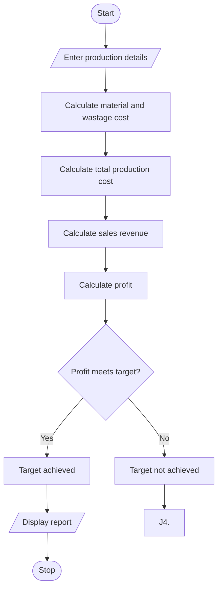

# 1. Problem statement
Develop a Python program to calculate manufacturing expenses, including raw materials, labour, wastage, and machine costs. Calculate the selling revenue and determine whether the production meets the required profit target.
# 2. Algorithm
1. Read the quantity produced and material cost per unit.
2. Read labour cost, machine cost, wastage percentage, and selling price per unit.
3. Calculate material cost and wastage cost.
4. Calculate total production cost.
5. Calculate revenue and profit.
6. Compare the profit with the required target.
7. Display the profitability report.
# 3. Flowchart (Mermaid)

# 4. Python source code

print("MANUFACTURING COST ANALYSIS")

qty = int(input("Quantity produced: "))
material = float(input("Material cost per unit: "))
labour = float(input("Total labour cost: "))
machine = float(input("Machine cost: "))
wastage_rate = float(input("Wastage percentage: "))
selling_price = float(input("Selling price per unit: "))
target = float(input("Required profit: "))

if (qty <= 0 or min(material, labour, machine,
                    selling_price, target) < 0
        or not 0 <= wastage_rate <= 100):
    print("Invalid input")
else:
    material_cost = qty * material
    wastage_cost = material_cost * wastage_rate / 100

    total_cost = material_cost + wastage_cost + labour + machine
    revenue = qty * selling_price
    profit = revenue - total_cost

    print("\n--- PRODUCTION REPORT ---")
    print("Material Cost:", round(material_cost, 2))
    print("Wastage Cost:", round(wastage_cost, 2))
    print("Total Cost:", round(total_cost, 2))
    print("Revenue:", round(revenue, 2))
    print("Profit:", round(profit, 2))

    if profit >= target:
        print("Profit Target: Achieved")
    else:
        print("Profit Target: Not Achieved")
# 5. Sample input
Quantity produced: 100
Material cost per unit: 100
Total labour cost: 2000
Machine cost: 1000
Wastage percentage: 5
Selling price per unit: 150
Required profit: 2000
# 6. Sample output
--- PRODUCTION REPORT ---
Material Cost: 10000.0
Wastage Cost: 500.0
Total Cost: 13500.0
Revenue: 15000.0
Profit: 1500.0
Profit Target: Not Achieved
# 7. Output screenshot

