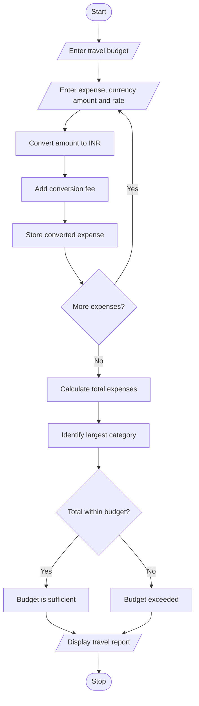

# 1. Problem statement
Create a Python program to convert travel expenses from foreign currencies into Indian rupees using supplied exchange rates. Include conversion fees, compare the expenses against a budget, and identify the largest expense category.
# 2. Algorithm
1. Enter the travel budget in Indian rupees.
2. Enter the expense categories and amounts in foreign currency.
3. Enter the exchange rate for each currency.
4. Calculate the converted amount and conversion fee.
5. Calculate the total travel expenses.
6. Compare the expenses with the budget.
7. Identify the largest expense category and display the report.
# 3. Flowchart (Mermaid)

# 4. Python source code

print("TRAVEL BUDGET ANALYSIS")

budget = float(input("Travel budget in INR: "))
n = int(input("Number of expense categories: "))

expenses = []

if budget < 0 or n <= 0:
    print("Invalid input")
else:
    for i in range(n):
        category = input("Expense category: ")
        amount = float(input("Amount in foreign currency: "))
        rate = float(input("Exchange rate (INR per unit): "))

        if amount < 0 or rate <= 0:
            print("Invalid amount or exchange rate")
            continue

        converted = amount * rate
        fee = converted * 0.02
        total = converted + fee

        expenses.append((category, total))
        print(category, "Total INR:", round(total, 2))

    if expenses:
        total_expense = sum(x[1] for x in expenses)
        largest = max(expenses, key=lambda x: x[1])

        print("\n--- TRAVEL REPORT ---")
        print("Total Expense: Rs.", round(total_expense, 2))
        print("Budget: Rs.", round(budget, 2))
        print("Largest Expense:", largest[0])

        if total_expense <= budget:
            print("Budget Status: Within Budget")
        else:
            print("Budget Status: Exceeded")

# 5. Sample input
Travel budget in INR: 50000
Number of expense categories: 3

Expense category: Hotel
Amount in foreign currency: 100
Exchange rate (INR per unit): 85

Expense category: Food
Amount in foreign currency: 150
Exchange rate (INR per unit): 85

Expense category: Transport
Amount in foreign currency: 200
Exchange rate (INR per unit): 85
# 6. Sample output
Hotel Total INR: 8670.0
Food Total INR: 13005.0
Transport Total INR: 17340.0

--- TRAVEL REPORT ---
Total Expense: Rs. 39015.0
Budget: Rs. 50000.0
Largest Expense: Transport
Budget Status: Within Budget
# 7. Output screenshot

    

